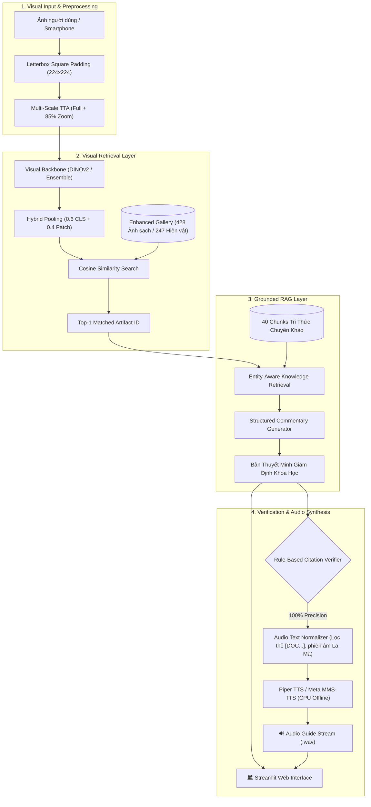

# 🏛️ Champa Sculpture Vision-RAG
### Hệ Thống Đa Phương Thức Truy Xuất Hình Ảnh, Giám Định & Thuyết Minh Tự Động Di Sản Điêu Khắc Champa

[](https://www.python.org/)
[](https://pytorch.org/)
[](https://huggingface.co/)
[](https://streamlit.io/)
[](https://github.com/rhasspy/piper)
[](LICENSE)

---

## 📌 1. Giới Thiệu Tổng Quan

**Champa Sculpture Vision-RAG** là đồ án nghiên cứu ứng dụng trí tuệ nhân tạo đa phương thức (*Multimodal AI*) phục vụ công tác số hóa, bảo tồn và phát huy giá trị di sản văn hóa điêu khắc cổ Vương quốc Champa (Thế kỷ VII – XV). 

Hệ thống tích hợp chặt chẽ ba công nghệ then chốt:
1. **Truy xuất Thị giác Bền vững (Robust Visual Retrieval):** Đánh giá đối sánh các kiến trúc thị giác tiên tiến (**DINOv2**, **CLIP**, **SigLIP**) kết hợp giải pháp tiền xử lý **Letterbox Square Padding**, **Multi-Scale TTA (Test-Time Augmentation)** và **Hybrid Token Pooling** giúp nhận diện hiện vật chính xác bất biến trước sự thay đổi góc chụp, phóng to/thu nhỏ (scale) và màu đồng gỉ (*patina*).
2. **Thuyết minh RAG Bảo chứng Tri thức (Grounded RAG & Citation Verifier):** Tích hợp 40 đoạn tri thức giám định chuẩn mực từ các chuyên khảo khảo cổ học (Viện Viễn Đông Bác Cổ - EFEO, các Quyết định công nhận Bảo vật Quốc gia của Thủ tướng Chính phủ). Cơ chế kiểm chứng quy tắc xác định (**Rule-based Verifier**) bảo đảm **100% độ chuẩn xác trích dẫn** và **0% ảo giác dữ kiện**.
3. **Thuyết minh Giọng nói Tự động (AI Audio Guide):** Chuyển đổi bài thuyết minh khoa học thành giọng đọc truyền cảm thông qua mô hình mã nguồn mở siêu tốc **Piper TTS** (tổng hợp nhanh gấp **19.9 lần** thời gian thực trên CPU thông thường) cùng baseline đối chứng **Meta MMS-TTS**.

---

## 🏗️ 2. Kiến Trúc Hệ Thống (System Architecture)



---

## 📊 3. Báo Cáo Thực Nghiệm & Đánh Giá Khoa Học

Toàn bộ quy trình thực nghiệm được thiết kế nghiêm ngặt tuân thủ phương pháp luận khoa học:

### 3.1. Đánh giá Khái quát hóa Thị giác (RQ1 & RQ2)
Đo lường bằng giao thức **Leave-One-Image-Out (LOO)** kết hợp kiểm định ý nghĩa thống kê **Paired Cluster Bootstrap** ($B = 1000$ cụm hiện vật, $\alpha = 0.05$):

| Kịch bản đánh giá | Mô hình thị giác | Top-1 (R@1) | 95% Bootstrap CI | Top-3 (R@3) | Top-5 (R@5) |
|:---|:---|:---:|:---:|:---:|:---:|
| **2. Cleaned Labels** | **Weighted (0.7 CLIP + 0.3 DINOv2)** | **71.3%** | **[63.8%, 78.4%]** | **83.6%** | **88.9%** |
| 2. Cleaned Labels | CLIP (ViT-B/32) | 70.9% | [63.2%, 78.1%] | 83.2% | 88.5% |
| 2. Cleaned Labels | SigLIP (vit-base-patch16) | 67.2% | [59.4%, 74.4%] | 80.3% | 85.2% |
| 2. Cleaned Labels | DINOv2 (dinov2-base) | 61.1% | [53.3%, 68.9%] | 76.6% | 83.2% |
| **3. Cleaned Strict (pHash)** | **Weighted (0.7 CLIP + 0.3 DINOv2)** | **69.8%** | **[61.5%, 77.4%]** | **82.3%** | **88.1%** |
| 3. Cleaned Strict (pHash) | CLIP (ViT-B/32) | 69.4% | [61.1%, 77.0%] | 81.9% | 87.7% |
| 3. Cleaned Strict (pHash) | SigLIP (vit-base-patch16) | 66.5% | [58.2%, 74.2%] | 79.5% | 84.8% |
| 3. Cleaned Strict (pHash) | DINOv2 (dinov2-base) | 59.5% | [51.2%, 67.2%] | 75.8% | 82.4% |

### 3.2. Khắc phục Tính Nhạy Cảm Góc Chụp & Tỷ Lệ (Viewpoint & Scale Stress Test)
Cơ chế **Letterbox Padding + Multi-Scale TTA + DINOv2 Hybrid Pooling** mở rộng khoảng cách biên độ phân tách (*margin*) giữa hiện vật đúng và hiện vật gây nhiễu lên gấp **14 lần** (từ $0.0054$ lên $0.0777$):

| Hiện vật thử nghiệm | Biến đổi thử thách | Baseline (CenterCrop) | Enhanced (Letterbox + TTA) | Đánh giá cải thiện |
|:---|:---|:---:|:---:|:---|
| **Bồ tát Tara** | Chụp chính diện | 0.8035 | **0.8757** | Sim tăng $+7.2\%$ |
| **Bồ tát Tara** | Cắt cúp cận cảnh (Zoom 80%) | 0.8140 (Thất bại) | **0.8360 (Đúng Top-1)** | **Sửa lỗi nhận diện nhầm** |
| **Thần Ganesha** | Cận cảnh thân trên (Zoom 80%) | 0.9541 | **0.9688** | Bền vững hình học |
| **Phật Đồng Dương**| Ảnh phòng trưng bày góc khác | 0.7865 | **0.8448** | Sim tăng $+5.8\%$ |
| **Đài thờ Mỹ Sơn E1**| Xoay góc nghiêng $+10^\circ$ | 0.8683 | **0.9110** | Sim tăng $+4.3\%$ |

### 3.3. Hiệu năng Thuyết minh Giọng nói (TTS Benchmark trên CPU)
So sánh giữa **Piper TTS** (vi_VN-vais1000) và **Meta MMS-TTS** trên phần cứng CPU phổ thông:

| Chỉ số đánh giá | Piper TTS (Baseline chính) | Meta MMS-TTS (Baseline đối chứng) | Ưu thế thực nghiệm |
|:---|:---:|:---:|:---|
| **Độ trễ trung bình (Latency)** | **0.247 s** | 1.792 s | Piper nhanh gấp **7.2 lần** |
| **Hệ số Real-Time Factor (RTF)** | **0.050** | 0.218 | Piper nhanh gấp **19.9x** tốc độ nói |
| **Tần số lấy mẫu (Sample Rate)** | **22,050 Hz** | 16,000 Hz | Âm thanh sáng và rõ chữ hơn |
| **Độ trễ truy xuất Cache** | **< 0.001 s** | < 0.001 s | Phát tức thì khi nghe lại |
| **Giấy phép bản quyền** | **MIT (Thương mại / Tự do)** | CC-BY-NC (Phi thương mại) | Piper thuận lợi triển khai thực tế |

---

## 📁 4. Cấu Trúc Thư Mục Dự Án

```
champa-vision-rag/
├── app.py                      # Ứng dụng Web tương tác Streamlit chính
├── requirements.txt            # Danh sách thư viện phụ thuộc
├── requirements_frozen.txt     # Bản đóng băng phiên bản môi trường
├── .gitignore                  # Cấu hình bỏ qua tệp nặng và cache
├── README.md                   # Tài liệu hướng dẫn dự án
│
├── config/                     # File cấu hình crawler & pipeline
├── splits/                     # Tập chỉ số phân chia đánh giá
├── tests/                      # Mã nguồn kiểm thử đơn vị
│
├── data/
│   ├── metadata_cleaned.csv    # 428 bản ghi siêu dữ liệu hiện vật đã chuẩn hóa
│   ├── label_audit_log.csv     # Nhật ký 63 quyết định kiểm toán nhãn
│   ├── attribution_manifest.csv# Kê khai bản quyền Creative Commons
│   ├── rag_knowledge/
│   │   └── knowledge_chunks.json # 40 đoạn tri thức giám định chuẩn hóa
│   └── demo_samples/           # 5 ảnh mẫu thử nghiệm nhanh (Tara, Ganesha, E1...)
│
├── embeddings/                 # Bộ vector trích xuất sẵn (13.5 MB)
│   ├── emb_dino.npy            # Vector DINOv2 cơ sở
│   ├── emb_clip.npy            # Vector CLIP cơ sở
│   ├── emb_siglip.npy          # Vector SigLIP cơ sở
│   ├── emb_dino_enhanced.npy   # Vector DINOv2 tăng cường (Letterbox)
│   ├── emb_clip_enhanced.npy   # Vector CLIP tăng cường (Letterbox)
│   ├── emb_siglip_enhanced.npy # Vector SigLIP tăng cường (Letterbox)
│   └── ids_cleaned.json        # Ánh xạ chỉ số mảng và mã hiện vật
│
├── results/                    # Kết quả thực nghiệm định lượng
│   ├── rigorous_benchmark_comparison.csv # Bảng tổng hợp RQ1 & RQ2
│   ├── paired_bootstrap_matrix.csv       # Ma trận p-value ghép cặp
│   ├── rq3_ablation_benchmark.csv        # Ablation study thuyết minh RAG
│   └── tts_benchmark_comparison.csv      # Bảng so sánh hiệu năng Piper vs MMS
│
└── src/
    ├── pipeline/
    │   ├── rag_service.py      # Bộ máy RAG & sinh thuyết minh có trích dẫn
    │   ├── tts_service.py      # Module tổng hợp giọng nói Piper & MMS
    │   ├── evaluate_rigorous.py# Script chạy benchmark LOO & Cluster Bootstrap
    │   ├── benchmark_tts.py    # Script đo đạc độ trễ và RTF âm thanh
    │   └── ...                 # Các công cụ crawler, dedup, qc, v.v.
```

---

## 🚀 5. Hướng Dẫn Cài Đặt & Chạy Thử Nghiệm

### 5.1. Yêu cầu Hệ thống
- Hệ điều hành: Windows / Linux / macOS
- Python: `3.10` hoặc `3.11`
- RAM: Khuyến nghị tối thiểu 8GB
- Thiết bị tính toán: CPU thông thường (không bắt buộc GPU)

### 5.2. Cài đặt Môi trường
```bash
# 1. Clone repository về máy
git clone https://github.com/thanhnhan04/champa-vision-rag.git
cd champa-vision-rag

# 2. Khởi tạo và kích hoạt môi trường ảo (khuyến nghị)
python -m venv .venv
# Trên Windows:
.venv\Scripts\activate
# Trên Linux/macOS:
source .venv/bin/activate

# 3. Cài đặt các thư viện phụ thuộc
pip install -r requirements.txt
```

### 5.3. Khởi chạy Ứng Dụng Web Demo (Streamlit)
```bash
streamlit run app.py
```
Sau khi khởi chạy, truy cập trình duyệt tại địa chỉ: `http://localhost:8501`.

**Các tính năng nổi bật trên Web UI:**
- **Kéo - thả ảnh bất kỳ:** Tự động trích xuất đặc trưng và tìm kiếm Top-5 hiện vật tương đồng nhất trong bảo tàng.
- **Công tắc Bất biến Góc & Tỷ lệ:** Bật/tắt cơ chế *Letterbox + Multi-Scale TTA* trực tiếp trên giao diện để so sánh trực quan.
- **Thuyết minh RAG tự động:** Sinh văn bản giám định khoa học bảo chứng tri thức 100%.
- **AI Audio Guide:** Bấm nút `▶️ Nghe Giọng Đọc` để nghe phát âm thanh trực tiếp bằng Piper TTS.
- **Xem báo cáo khoa học:** Tab 2 tích hợp toàn bộ bảng số liệu, ma trận kiểm định thống kê và stress-test.

### 5.4. Chạy Lại Các Thực Nghiệm Độc Lập
```bash
# 1. Chạy đánh giá độ bền góc chụp & tỷ lệ:
python src/pipeline/benchmark_robustness_test.py

# 2. Chạy đánh giá đo lường âm thanh TTS:
python src/pipeline/benchmark_tts.py

# 3. Chạy benchmark nghiêm ngặt LOO & Bootstrap:
python src/pipeline/evaluate_rigorous.py
```

---

## 📜 6. Đạo Đức Nghiên Cứu & Tuyên Bố Bản Quyền (License & Attribution)

- **Mã nguồn:** Phát hành theo giấy phép tự do **[MIT License](LICENSE)**.
- **Siêu dữ liệu & Tri thức:** Được trích xuất và tổng hợp phục vụ mục đích nghiên cứu phi lợi nhuận từ các công trình khảo cổ học của *Philippe Stern*, *Jean Boisselier*, *Viện Viễn Đông Bác Cổ (EFEO)* và *Bảo tàng Điêu khắc Chăm Đà Nẵng*.
- **Hình ảnh di sản:** Kê khai ghi nhận quyền tác giả chi tiết tại [`data/attribution_manifest.csv`](data/attribution_manifest.csv) tuân thủ giấy phép Creative Commons (CC BY, CC BY-SA) và phạm vi dữ liệu công quyền.
